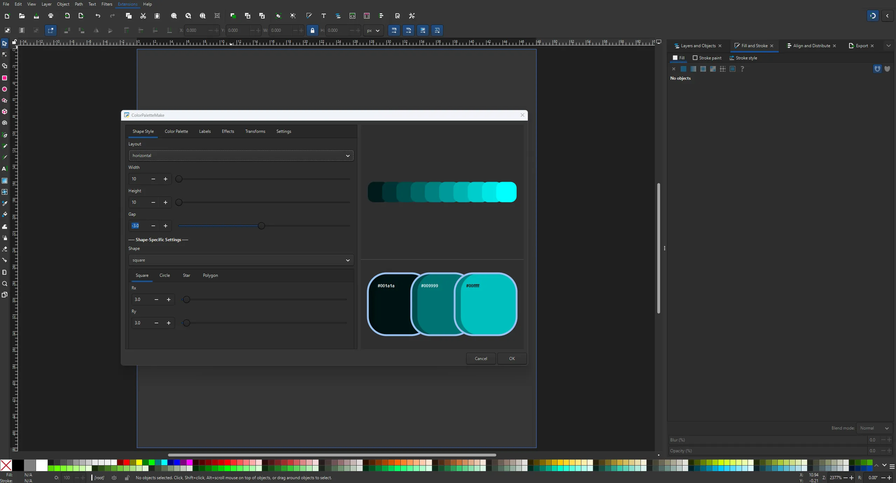

# ColorPaletteMake

> ColorPaletteMake is an Inkscape extension for building color palettes.
> 
> It's designed for creating swatch strips, color-scale graphics, legend cards, and anything else that requires laying out a smooth color ramp without doing it by hand.
> 
> 
---

### What it does

At its core, ColorPaletteMake interpolates between a start color and an end color, placing one shape per step along that ramp. You control the ramp (how many steps, or how large each step is), the shape, the layout, and a range of optional extras.

Everything updates live in a preview panel as you tweak the settings, so you can see the palette before it lands in your document.

---

### Tabs

The dialog is organized into six top-level tabs:

| Tab | What's in it |
|-----|--------------|
| **Shape Style** | Layout, size, gap, and per-shape settings |
| **Color Palette** | Ramp start/end colors and how to step between them |
| **Labels** | Text-on-shape labels and free-floating custom text |
| **Effects** | Stroke and shadow options |
| **Transforms** | Move, rotate, radial placement, skew, draw order |
| **Settings** | Dark mode, saved settings |

---

### Color Palette

Two modes, selected via the Color Mode dropdown:

- HSV — hue / saturation / value
- HSL — hue / saturation / lightness

The rest of the tab is divided into three sub-tabs:

**Ramp Start**

Hue, saturation, and the value/lightness slider. The label on that last slider switches between Value (%) and Lightness (%) depending on the selected color mode. A live swatch previews the resulting color.

**Ramp**

- Step Mode
  - Increment — you set how much the value/lightness changes per card (Increment by). The number of cards is derived from the start and end values.
  - Count — you set the total number of cards (Steps), evenly sampled between start and end.
- Reverse Order — flips the ramp direction.

Hue always interpolates along the shortest arc (so 350° → 10° passes through 0°, not the long way around), while saturation and value interpolate linearly.

**Ramp End**

Same controls as Ramp Start, applied to the end color.

---

### Labels

Two independent label systems, each with its own enable switch.

Text on Shape

Draws text centered on each card. Nested sub-tabs:

- Text Format
  - Label Text Display — HSV, HSL, RGB, or Hex.
  - Show Hex (#) — appends the hex code as a second line (ignored if the display is already set to Hex).
  - Label Size — as a percentage of card height.
  - Label Every Nth Card — thins out labels on dense palettes.
  - Font Weight — Normal, Bold, Light, Medium, Semibold, Heavy.
- Appearance
  - Auto-Contrast Label Color — selects black or white based on the card's perceived luminance.
  - Label Color — used when auto-contrast is off.
- Offsets
  - X / Y offsets, expressed as fractions of card width/height.

Middle-Out note: when the Draw Order mode is Middle-Out, the X offset slider is relabeled Push X, and its magnitude fans labels outward from the center card. The Y offset continues to work as a normal offset.

Custom

Adds your own free-form text (multi-line). Nested sub-tabs:

- Content — a multi-line text box.
- Style — font size, weight, color, and an auto-contrast option (only meaningful in Shape mode).
- Position — X/Y nudges in user units.
- Target (above the sub-tabs) — Palette (one text block placed relative to the whole palette) or Shape (one text block per card).
- Palette Placement (above the sub-tabs) — Center, Top, Bottom, Left, Right. Applies only when Target is set to Palette.

---

### Effects

**Stroke**

- Color & Width — color, width, unit (px or % of the card's short side), opacity.
- Style — line cap (butt / round / square), line join (miter / round / bevel), miter limit.
- Dashes — presets (Solid, Dashed, Dotted, Dash-dot, Long dash) plus a Custom option that accepts patterns such as 5,3 or 10 5 2 5.

The stroke is applied with paint-order: stroke fill, so it sits cleanly beneath the fill instead of eating into the shape.

**Shadow**

Two modes, selected via the Shadow Mode dropdown:

- Drop shadow — blur → offset → flood → composite, merged under the source.
- Inner shadow — matches Inkscape's own Inner Shadow filter: flood minus the offset shape, then clipped atop the source.

Both modes share:

- Apply to — Per card or Whole palette.
- Offset X / Y, Blur, Color, Opacity.

Switching between Drop and Inner flips the sign of the offsets, so "shadow toward bottom-right" stays visually consistent across modes.

Stroke + inner shadow: when both are enabled, the fill and stroke are emitted as two separate elements, and the shadow filter is applied only to the fill. This prevents the inner shadow from eating into the stroke.

---

### Transforms

Each transform has an enable switch and, where relevant, a Mode. Modes generally come in three flavors: Palette (applies to the whole group), Uniform (the same value for every card), and Cascade (card i receives i × the value).

- Move — offset X/Y. In Cascade mode, card i moves by i × the offset (the first card stays put).
- Rotate — angle in degrees. Palette rotates the whole group; Uniform rotates each card in place; Cascade rotates card i by i × the angle.
- Radial — places cards on a circle, one per step angle. Options: angle per step, radius, center (Palette Center / Document Origin / First Card), and Rotate Cards (points each card outward).
- Skew — horizontal and vertical angles. Uses the same Palette / Uniform / Cascade modes as Rotate.
- Draw Order — the z-order of the cards, useful when they overlap (negative gap).
  - Newest on Top — card N-1 drawn last.
  - Middle-Out — the middle card drawn last, with Text-on-Shape labels fanning outward.
  - Oldest On Top — card 0 drawn last.

---

### Settings

- Enable Dark Mode — takes effect the next time the dialog opens.
- Saved Settings — all widget values, the dark mode flag, and which tabs were open are saved to a JSON file next to the extension (color_palette_make.json) and restored on the next launch. A Reset to Defaults button wipes the file and resets every widget.

---

### The Preview Panel

The right-hand side of the dialog contains two stacked previews:

- Top (full palette) — every card in the current layout, with transforms and draw order applied, auto-fit to the panel. Labels are deliberately not drawn here, so a 100-card palette doesn't turn into a wall of text.
- Bottom (detail) — three sample cards (first, middle, and last) at readable size, with labels, stroke, and shadow.

Both previews are approximations of the real output: strokes are exact, but drop and inner shadows are drawn as hard-edged solid copies for speed rather than being blurred.

---

**Generated SVG Structure**

Each run creates a group labeled ColorPaletteMake-NNN on the current layer, where NNN increments per palette in the document. Inside:

- One element per card (two if both stroke and inner shadow are enabled — a fill and a stroke).
- Optional label text elements and custom text elements.
- A <g> wrapper carrying group-level rotate/skew transforms, if any.
- A <filter> in <defs> for the shadow, if enabled.

Per-card transforms are applied by wrapping the card's elements in their own <g>, so a fill and stroke pair always moves together.

---

### Requirements

- Inkscape _**1.4**_ or later.

> [!NOTE]
> All dependencies for this extension already ship with Inkscape's Python, so no extra setup is normally needed.

### Installing

Download the extension from the [releases page](../../releases), then place the ColorPaletteMake folder inside your Inkscape extensions directory.

Windows

```
%APPDATA%\inkscape\extensions\ColorPaletteMake\
```

Restart Inkscape. You'll find the extension at:

```
Extensions → Render → ColorPaletteMake → ColorPaletteMake
```

> [!IMPORTANT]
> A first-time install should work without issue. If Inkscape reports Extension "ColorPaletteMake" failed to load because a dependency was not met even though the files are in place, Inkscape's extension cache is stale. Close Inkscape completely, delete the cache file, and restart:

- Windows: %APPDATA%\inkscape\extension-cache
- Linux: ~/.config/inkscape/extension-cache
- macOS: ~/Library/Application Support/org.inkscape.Inkscape/config/inkscape/extension-cache

Inkscape rebuilds the cache on the next launch.

---

### Changelog

See [CHANGELOG.md](CHANGELOG.md) for version history.

---

### License

ColorPaletteMake is free software: you can redistribute it and/or modify it under the terms of the GNU General Public License as published by the Free Software Foundation, either version 2 of the License, or (at your option) any later version.

See [LICENSE](LICENSE) for the full text.

This extension imports inkex, which is part of Inkscape and licensed under the GPL v2+. To stay consistent with that, ColorPaletteMake is released under the same terms.

---

> [!IMPORTANT]
> This started as a personal tool. Issues and feature requests are welcome, but I can't promise fast turnarounds or accept all PRs — it grows when I need it to grow.

---

